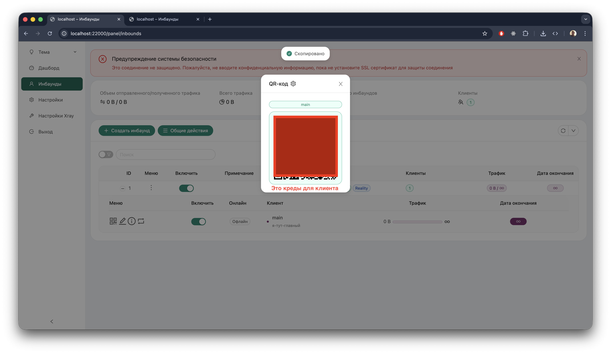

# Связка 3x-panel ru+зарубеж

Набор ansible плейбуков для поднятия связки 3x-panel ru+зарубеж

- Трафик на российские сервисы пойдет через ru-сервер, на зарубежные - проксируется на зарубежный. Используется VLESS + xtls-rprx-vision + steal-oneself
- Панель закрыта извне и доступна только через проброс порта через ssh.
- Сильно упрощенная версия. Используется для разовой настройки, НЕ КОММИТИТЬ vps.yml без внедрения ansible-vault

## Инструкция:

- Регистрируемся на dockerhub, выписываем персональный токен
- Арендуем две VPS - ru и зарубеж
- Покупаем домен
- Создаём два поддомена: для ру-части и зарубеж-части и направляем каждый на свою VPS через A-запись в DNS
- Указываем нужные параметры в ansible/inventory/vps.yml
- Запускаем:
    - make build
    - make setup
    - make 3x-ui
    - make caddy
- На каждом сервере поднимется Caddy-сервер и 3X-UI с минимально преднастроенной базой-шаблоном

- Настраиваем зарубежную часть:
    - Пробрасываем 22055 порт с зарубежного сервера на локалку:
      ```shell
      ssh -L 22000:localhost:22055 <ssh-пользователь>@<хост-зарубежного-сервера>
      ```
    - Заходим в панель по адресу http://localhost:22000/ . Логин: `3x-private` , пароль: `KwGJIG4XyX`
    - При желании меняем пароль от панели (Настройки -> Учётная запись)
    - Настраиваем панель как указано в [1-world](panel-setup/1-world)
    - Выходим из ssh-проброса порта

- Настраиваем RU-часть:
    - Пробрасываем 22055 порт с ru-сервера на локалку:
      ```shell
      ssh -L 22000:localhost:22055 <ssh-пользователь>@<хост-ru-сервера>
      ```
    - Заходим в панель по адресу http://localhost:22000/ . Логин: `3x-private` , пароль: `KwGJIG4XyX`
    - При желании меняем пароль от панели (Настройки -> Учётная запись)
    - Настраиваем панель как указано в [2-ru](panel-setup/2-ru)
    - Выходим из ssh-проброса порта

- Используем креды из ру-части для клиента 
